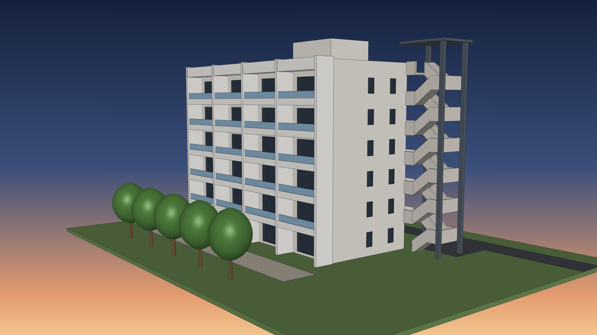
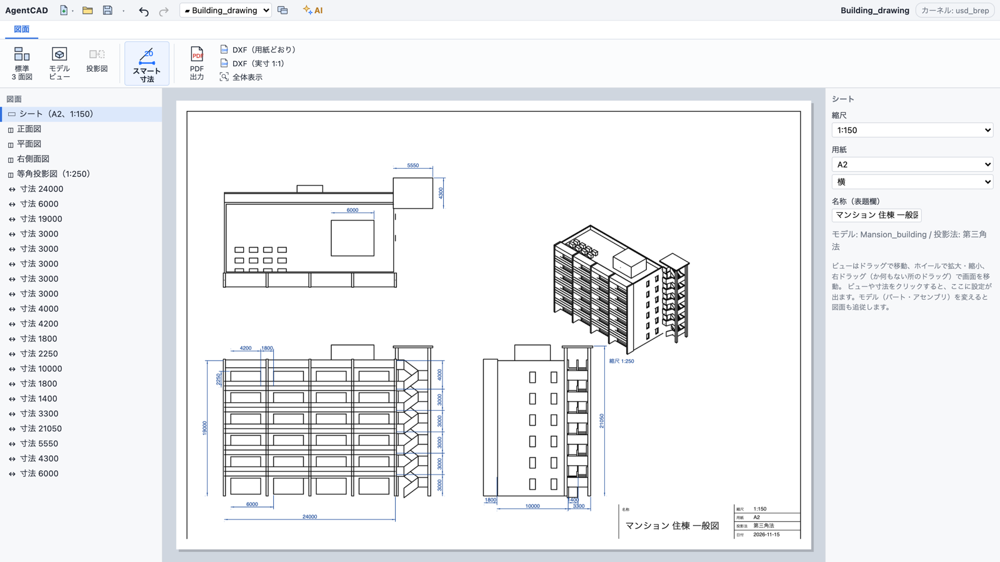
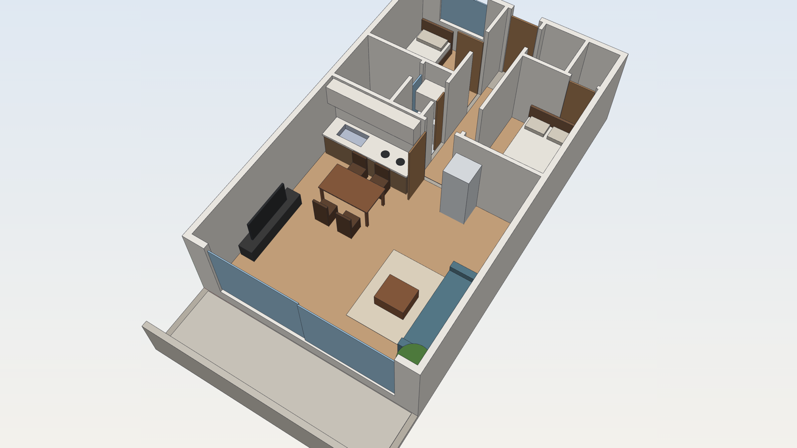
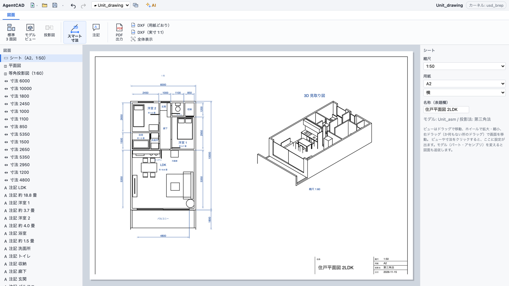
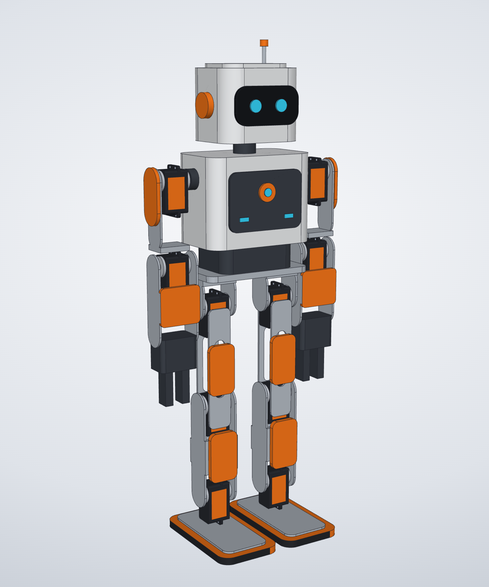
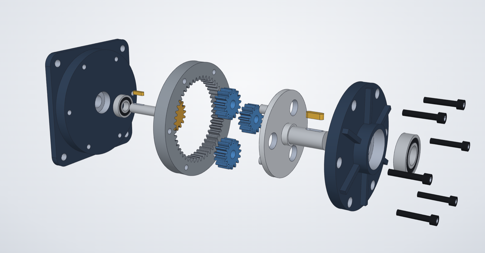

# AgentCAD

[English](README.md) | **日本語**

> **注意: 個人用に作ったプロジェクトです。** 作者が自分で使うために作ったもので、今後の更新・不具合修正・
> Issue や Pull Request への対応は期待しないでください。そのまま参考にしたり、フォークして自由に使ってください（MIT ライセンス）。

パラメトリック 3D CAD（個人で開発している実験的なプロジェクト）。
スケッチの拘束ソルバ・フィーチャーツリー・アセンブリの合致を自前で実装し、形状演算（BRep）は
[usd-brep](https://pypi.org/project/usd-brep/) に任せています。UI は自作の WebGL2（外部ライブラリなし）、ロジックは Python、
デスクトップ版は Tauri。保存形式は OpenUSD（`.usda`）。

主な機能: スケッチ（拘束・スマート寸法・推測とスナップ）、押し出し / カット・回転・スイープ・穴ウィザード・フィレット・面取り・
シェル・パターン・ミラー、式と変数、外観（色）、断面表示、アセンブリ（合致・干渉チェック・動かしてみる）、2 次元図面（PDF・DXF）、
AI アシスタント（Claude / OpenAI 互換の API で、自然な言葉でモデルを作る・操作する）。

作例（画像をクリックすると大きく表示）:

<table>
<tr>
<td><a href="docs/images/mansion.png"></a></td>
<td><a href="docs/images/mansion_drawing.png"></a></td>
<td><a href="docs/images/unit_3d.png"></a></td>
<td><a href="docs/images/unit_drawing.png"></a></td>
</tr>
<tr>
<td>マンション（6 階建て）。階段は 1 層分のパートを部品パターンで 6 層に</td>
<td>住棟の図面（アセンブリから投影し、寸法を入れたもの）</td>
<td>住戸（2LDK）の 3D 見取り図。躯体・床・住設・家具の 4 パート</td>
<td>住戸の平面図（寸法と、注記で室名・畳数）</td>
</tr>
<tr>
<td><a href="docs/images/robot.png"></a></td>
<td><a href="docs/images/robot_drawing.png"></a></td>
<td><a href="docs/images/gearbox.png"></a></td>
<td><a href="docs/images/gearbox_drawing.png"></a></td>
</tr>
<tr>
<td>小型の人型ロボット（全高 488 mm）。サーボ 10 個は同じパートを 10 回使う</td>
<td>ロボットの組立図（4 つのビュー・寸法・部品表）</td>
<td>遊星歯車減速機（減速比 3.67）の分解図。歯形はインボリュート曲線、遊星とボルトは円形パターン</td>
<td>減速機の組立図（隠線つきの側面図・直径寸法・歯車の諸元・部品表）</td>
</tr>
</table>

※ 作例はすべて AI エージェントがこのアプリの API を使って生成したもので、**設計として実用レベルではありません**
（寸法・構造・部品の構成は見た目のための仮のもので、強度・可動範囲・施工などは検討していません）。
モデル（`.usda`）・図面・生成スクリプト・スクリーンショットはサンプルとして [Data/](Data/) に置いています
（`Mansion`・`Unit`・`Robot`・`Gearbox`。各フォルダの `build_*.py` を `core` から実行すると作り直せます）。

- 計画: [docs/PLAN.md](docs/PLAN.md)
- 仕様: [docs/SPEC.md](docs/SPEC.md)
- 設計判断: [docs/DECISIONS.md](docs/DECISIONS.md)
- 開発の引き継ぎ: [CLAUDE.md](CLAUDE.md)

## 必要なもの
- Python 3.12（usd-brep が 3.12 用）と、`pip install numpy scipy usd-brep`（開発では usd-brep 1.0.1）
- AI アシスタントを使うなら `pip install anthropic`、テストは `pip install pytest`（画面の確認は `pip install playwright`）
- Windows で開発・確認しています。macOS（Apple Silicon）でも動きますが、usd-brep に macOS 用の配布が無いため
  ソースからのビルドが要ります（[macOS（Apple Silicon）でのビルド](#macosapple-siliconでのビルド)）

## 起動（Windows）
上の venv を有効にしてから、リポジトリ直下で:
```
run.bat --demo
```
ブラウザが開き、デモ部品（板・ボス・穴・フィレット）が表示されます。`run.bat --demo car` なら車のデモ部品
（新規 ▾ →「デモ（車）」でも作れます）。終了はコンソールで Ctrl+C。
usd-brep が無い環境では簡易カーネル（押し出しと和のみ）で動きます。

## AI アシスタント
標準ツールバーの「AI」（または 新規 ▾ →「AI で作成…」）で右にパネルが開きます。初回は ⚙ で API キーを入れてください
（Claude なら Anthropic の API キー。既定のモデルは claude-opus-5-5）。接続先を「OpenAI 互換」にすると ChatGPT や、
Ollama・LM Studio などの手元のモデルも使えます（接続先 URL を設定）。設定は `~/.agentcad/agent.json` に保存されます。
Claude を使うには venv に SDK が要ります:
```
pip install anthropic
```

## テスト
```
cd core
python -m pytest
```
必要: Python 3.12+, numpy, scipy（UI の画面確認 `scripts/ui_smoke.py` は playwright と Chrome も）

ソルバの速度を測る: `cd core && python ../scripts/bench_solver.py`

再生成の速度を測る（usd-brep が要る）: `cd core && python ../scripts/bench_regen.py`

## 実カーネルでのテスト（Windows、リポジトリ直下で）
カーネルは usd-brep（調査の記録: [docs/PHASE0.md](docs/PHASE0.md)）。
```
python -m pytest core\tests\test_kernel_conformance.py core\tests\test_part_real_kernel.py -v -s
```
`-s` を付けると再生成の時間も表示されます。

## 操作
| 操作 | 方法 |
|---|---|
| ツールバー | 1 段目 = 新規・開く・保存・元に戻す。2 段目 = タブ（フィーチャー / スケッチ / アセンブリ）。表示の切り替えは 3D ビューの上の中央 |
| 回転 / パン / ズーム | 中ドラッグ / Ctrl+中ドラッグ（または右ドラッグ）/ ホイール（Shift+中ドラッグ） |
| 表示方向 | Ctrl+1〜7（正面・背面・左・右・平面・底面・等角）、Ctrl+8 = 選んだ面・平面に正対、F = 全体表示 |
| スケッチを始める | 面かツリーの平面を選んで「スケッチ」 |
| フィーチャーを作る | ボタンを押す → 右のパネルで値を変える → ✓（Enter）で確定 / ✗（Esc）で取り消し |
| パターン・ミラー | 元の押し出し・カットをツリーで選んでボタン。向き・軸・平面は右のパネルで選ぶ |
| スケッチの拘束 | 要素をクリック（Ctrl で追加。赤い点の原点も選べる）→ 右のパネルに付けられる拘束のボタンが出る |
| スケッチの寸法 | スケッチのタブの「スマート寸法」（D）→ 要素をクリック → 置く所をクリック → 値。例: 原点と矩形の辺 → 置く → 20 |
| スナップ | 描くとき、線の中点・円の中心・端点（自分・ほかのスケッチ・モデルのエッジ）に自動で吸い付き、拘束が付く。既存の点と縦・横に揃うと青い点線（推測線） |
| 寸法の相手 | スマート寸法で、ほかのスケッチやモデルの点・エッジ（角・中点・円の中心・直線エッジ）もクリックできる。モデルが変わると追従 |
| 選択フィルタ | 3D ビューの上の左端。面だけ / エッジだけ / 頂点だけ にできる |
| ループ・別の選択 | エッジを右クリック → ループを選択 / 正接の連続を選択。面を右クリック → 別の選択（奥の面を選ぶ） |
| 計測・質量特性 | 評価のタブ。計測は面・エッジ・頂点をクリック（2 つで距離・角度）、Esc で終了 |
| アセンブリの道具 | アセンブリのタブ: 直線 / 円形パターン（部品）・干渉チェック。部品の一覧の ⧉ で複製、合致の一覧で名前をクリックすると合致を編集 |
| スイープ | 経路のスケッチ（つながった線・円弧）と、経路の始点に垂直な断面のスケッチ（閉じた輪郭）を描く → 断面のスケッチを選んで「スイープ」→ ✓。カットは右のパネルの操作で |
| 図面 | パートかアセンブリを開いて 新規 ▾ → 図面（標準 3 面図つき）。図面のタブ: モデルビュー・投影図・スマート寸法・注記・PDF 出力・DXF（用紙どおり / 実寸 1:1）。縮尺・用紙は右のパネル。ビューはドラッグで移動、ホイールで拡大 |
| 穴ウィザード | 面を選んで「穴ウィザード」→ 穴の位置に点を置く → スケッチ終了 → 右のパネルで種類（ザグリ・皿・キリ・ねじ下穴・ドリル）とサイズ（M2〜M20）→ ✓ |
| ほかのスケッチ | 使っていないスケッチは表示、ツリーで選んだスケッチは必ず表示。右クリックで表示 / 非表示。スケッチ中はその点・線にスナップ（参照先に追従） |
| 合致 | アセンブリで「📎 合致」→ 面を 2 つクリック → 部品が動く → ポップアップで種類・値・整列 → ✓（続けて次）/ ✗。終わるときは右の ✓ |
| ウィンドウ | 部品の「開く」でパートを別ウィンドウに。「⧉」でほかの文書を別ウィンドウに。デスクトップ版は新規・開くも別ウィンドウ |
| メニュー | ツリーや 3D で右クリック（編集・名前の変更・抑制・削除・この面にスケッチ など） |
| 名前の変更 / 削除 | F2 / Del |

ブラウザで開いた場合、Ctrl+1〜8 はブラウザのタブ切り替えに取られることがあります（デスクトップ版では使えます。
ツールバーの「表示方向」からも選べます）。

## デスクトップ版（Tauri）
ブラウザの代わりに専用のウィンドウで動かせます。必要なもの: Node.js、[Rust](https://rustup.rs/)、Visual Studio の C++ ビルドツール。

Python の場所を指定します（初回だけ）。リポジトリ直下に `agentcad.config.json` を作ります（例: `agentcad.config.example.json`）。

```json
{ "python": "C:\\path\\to\\venv\\Scripts\\python.exe", "kernel": "auto" }
```

```
cd app
npm install
npm run tauri dev      :: 開発用に起動（初回のビルドは数分）
npm run tauri build    :: 実行ファイルを作る → app\src-tauri\target\release\agentcad.exe
```

`agentcad.exe` はリポジトリの中に置いたまま使います（`core` を探して Python サーバを起動します）。
別の場所に置くときは環境変数 `AGENTCAD_ROOT` にリポジトリの場所を設定してください。
Python サーバの出力は `%TEMP%\agentcad-server.log` です。

## macOS（Apple Silicon）でのビルド
usd-brep は PyPI・GitHub Releases に Linux と Windows 用しかないため、macOS ではソースからビルドします
（公式の手順: usd-brep の `BUILDING.md` の「macOS local development」）。公式の手順だけでは通らない所があるので、
ここでは 2026-11 に macOS（Apple Silicon）・Xcode 26（clang 21）で通した手順を書きます。所要時間は全体で 30 分ほどです。
以下では、ソースを `~/src`（AgentCAD も `~/src/AgentCAD` に clone 済みとします）、OpenUSD のインストール先を `~/opt`（usd-brep の既定）に置きます。
コマンドはすべて同じシェルで続けて打つ前提です（途中で決めた環境変数を後で使います）。

### 必要なもの
- Xcode（またはコマンドラインツール）、git
- [uv](https://docs.astral.sh/uv/)（Python 3.12 と venv を作る）、CMake（`brew install cmake`）
- デスクトップ版も使うなら Node.js と [Rust](https://rustup.rs/)

### 1. Python 3.12 の venv
AgentCAD のリポジトリ直下に `.venv` を作ります（`.gitignore` 済み）。
```
export SRC=~/src
export USD_ROOT=~/opt/usd-25.11-py312
export JOBS="$(sysctl -n hw.ncpu)"

cd "$SRC/AgentCAD"
uv venv --python 3.12
source .venv/bin/activate
uv pip install numpy scipy pytest playwright anthropic
```
uv の venv には pip が入っていないので、パッケージの追加は `uv pip install` を使います。

### 2. OpenUSD 25.11（Python 3.12 用、描画系なし）
```
git clone --depth 1 --branch v25.11 https://github.com/PixarAnimationStudios/OpenUSD.git "$SRC/OpenUSD"
python "$SRC/OpenUSD/build_scripts/build_usd.py" "$USD_ROOT" \
  --no-imaging --no-examples --no-tutorials --no-tools --no-docs --no-materialx \
  --python --build-variant release -j "$JOBS" \
  --build-args USD,"-DPXR_PY_UNDEFINED_DYNAMIC_LOOKUP=ON"
```
- `-DPXR_PY_UNDEFINED_DYNAMIC_LOOKUP=ON` が必須です。uv の Python は libpython を実行ファイルに静的に持っているため、
  これが無いと USD が libpython を別にもう 1 つ読み込み、`import` した時点でクラッシュします（Segmentation fault）
- インストール先（`$USD_ROOT`）は `--build-args` より前に書きます（後ろに書くと `--build-args` の値と見なされます）
- 確かめ方: `PYTHONPATH="$USD_ROOT/lib/python" python -c "from pxr import Usd"` でエラーが出なければ OK

### 3. premake 5.0.0-beta2
usd-brep のビルドに使う premake の macOS 版は公開されていません。Homebrew の premake（5.0.0 正式版）は usd-brep の
設定ファイル（`flags`）を読めないので、Linux 版と同じ 5.0.0-beta2 をソースからビルドします。
今の clang でビルドを通すため、同梱の zlib を 1 か所直します。
```
cd "$SRC"
curl -fsSLO https://github.com/premake/premake-core/releases/download/v5.0.0-beta2/premake-5.0.0-beta2-src.zip
unzip -q premake-5.0.0-beta2-src.zip && cd premake-5.0.0-beta2-src
sed -i '' 's|#        define fdopen(fd,mode) NULL /\* No fdopen() \*/|/* fdopen patched out */|' contrib/zlib/zutil.h
CFLAGS="-Wno-implicit-function-declaration -include unistd.h" make -C build/gmake2.macosx config=release -j "$JOBS"
```
できた `bin/release/premake5` を、usd-brep のビルドが探す packman のキャッシュに置きます（名前は usd-brep が指定する版のまま）。
```
D="$HOME/Library/Application Support/packman-cache/chk/premake/5.0.0-beta1+nv1-macos-universal"
mkdir -p "$D" && cp bin/release/premake5 "$D/" && touch "$D/.packman.sha1"
```

### 4. usd-brep 1.0.1
```
git clone --depth 1 --branch v1.0.1 https://github.com/NVIDIA-Omniverse/usd-brep.git "$SRC/usd-brep"
cd "$SRC/usd-brep"
```
ビルドの設定を 3 か所直します（下の `git apply` をそのまま打つ）。
- `premake5-libraries.lua`: 2 と同じ理由で、共有ライブラリ・拡張モジュールは libpython をリンクしない
- `premake5-utils.lua`: clang 21 で増えた警告でビルドを止めない（`-Wno-error`）
- `repo.toml`: macOS 用の依存関係の指定が使われない（ホストの `macos-aarch64` で評価される）ので、同じ指定を足す
```
git apply <<'EOF'
--- a/premake5-libraries.lua
+++ b/premake5-libraries.lua
@@ -126,9 +126,12 @@ function use_python()
         libdirs { target_deps.."/python/libs" }
         externalincludedirs { target_deps.."/python/include" }
     filter { "system:macosx" }
+        externalincludedirs { target_deps.."/python/include/python3.12" }
+    filter { "system:macosx", "kind:SharedLib" }
+        linkoptions { "-undefined dynamic_lookup" }
+    filter { "system:macosx", "kind:not SharedLib" }
         links { "python3.12" }
         libdirs { target_deps.."/python/lib" }
         linkoptions { "-Wl,-rpath," .. target_deps .. "/python/lib" }
-        externalincludedirs { target_deps.."/python/include/python3.12" }
     filter {}
 end
--- a/premake5-utils.lua
+++ b/premake5-utils.lua
@@ -120,6 +120,7 @@ function macos_warning_suppressions()
         "-Wno-unused-but-set-variable",
         "-Wno-unused-variable",
         "-Wno-parentheses-equality",
+        "-Wno-error",
     }
 end
 
--- a/repo.toml
+++ b/repo.toml
@@ -55,6 +55,9 @@ fetch.packman_target_files_to_pull = [
 fetch."platform:macos-universal".packman_target_files_to_pull = [
     "${root}/deps/target-deps-python-macos.packman.xml",
 ]
+fetch."platform:macos-aarch64".packman_target_files_to_pull = [
+    "${root}/deps/target-deps-python-macos.packman.xml",
+]
 
 msbuild.sln_file = "usd-brep.sln"
 
EOF
```
ビルドします（venv を有効にしたまま）。`SMLIB_PYTHON_ROOT` は venv の元になった Python、
`SMLIB_MACOS_ARM64_ONLY=1` は arm64 だけのビルド（OpenUSD が arm64 だけなので、既定のユニバーサルではリンクできない）。
```
export SMLIB_PYTHON_ROOT="$(python -c 'import sys; print(sys.base_prefix)')"
export SMLIB_MACOS_ARM64_ONLY=1
export SMLIB_USD_ROOT="$USD_ROOT"
./tools/scripts/setup-macos-local-deps.sh
./prebuild.sh -p macos-universal
./repo.sh build -p macos-universal -r -j "$JOBS"
```
venv から使えるようにします。`.pth` でビルド結果のフォルダを見せ、USD 保存に要るスキーマ（omniSolid）は
シンボリックリンクで `usd_brep` が探す場所に置きます（環境変数は要りません）。
```
echo "$PWD/_build/macos-universal/release" > "$(python -c 'import site; print(site.getsitepackages()[0])')/usd_brep_local.pth"
ln -sfn ../schema/omniSolid _build/macos-universal/omniSolid
```
確かめ方: `python -c "import usd_brep as ub; print(len(ub.primitives.create_box((0,0,0),1,1,1).faces()))"` が 6 を出す。
AgentCAD のテスト（`cd core && python -m pytest -q`）で実カーネルのテストも走ります。

`_build` を消したときや uv の Python を更新したとき（`sys.base_prefix` が変わる）は、この 4 をやり直します。

### 起動（macOS）
```
cd core
python -m cad.api --demo
```
デスクトップ版は上の「デスクトップ版（Tauri）」と同じ手順です。`agentcad.config.json` の `python` には venv の Python
（例: `/Users/<ユーザー名>/src/AgentCAD/.venv/bin/python`）を書きます。Python サーバの出力は `$TMPDIR/agentcad-server.log` です。

## ほかのソフトとのやりとり（STL・3MF・OBJ）
- **書き出し**: 保存ボタンの横の ▾ →「STL / 3MF / OBJ で書き出し…」。パートもアセンブリも書き出せます（単位 mm）。
  3D プリンタには 3MF（部品ごと・色つき）か STL、Blender には OBJ（色は同じ名前の `.mtl`）。
  同じメニューの「細かさ」で曲面の三角形の細かさ（粗い / 標準 / 細かい）を選べます
- **読み込み**: 「開く」で `.stl` / `.3mf` / `.obj` を選ぶと、取り込んだ形（インポート）の新しいパートになります。
  表示・計測・面へのスケッチ・アセンブリの部品と合致・図面に使えますが、形を変える操作（押し出しの追加・カット・フィレットなど）はできません
- STEP には対応していません

## 保存形式
USD のテキスト形式（`.usda`）。パートはフィーチャー定義・表示メッシュ・BRep（`名前_body.usda` を参照）、
アセンブリはパートを reference します（詳細: [docs/SPEC.md](docs/SPEC.md) 8 章）。旧形式の `.ucpart` / `.ucasm` も開けます。

## ライセンス
[MIT](LICENSE)。usd-brep などの依存ライブラリは、それぞれのライセンスに従います。
