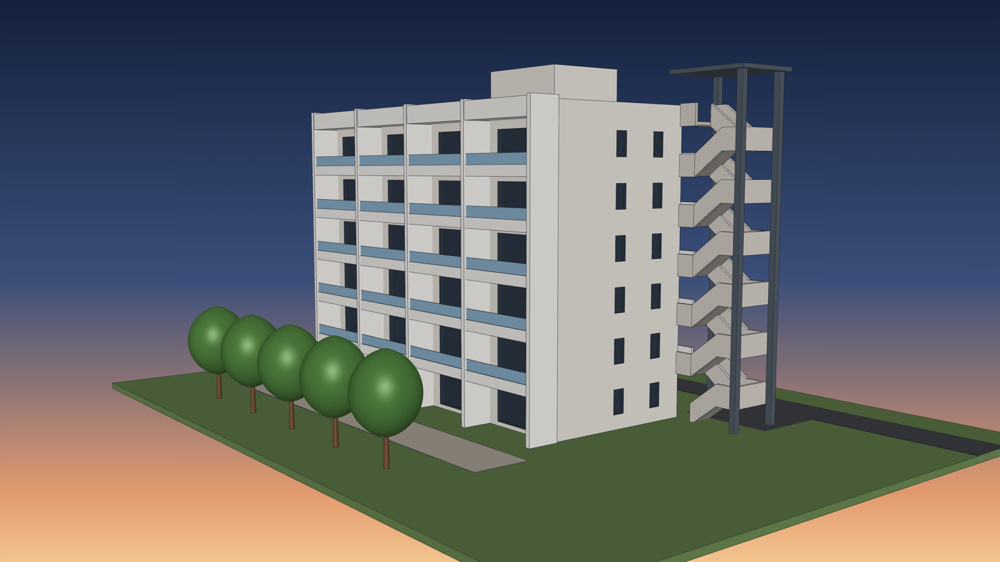
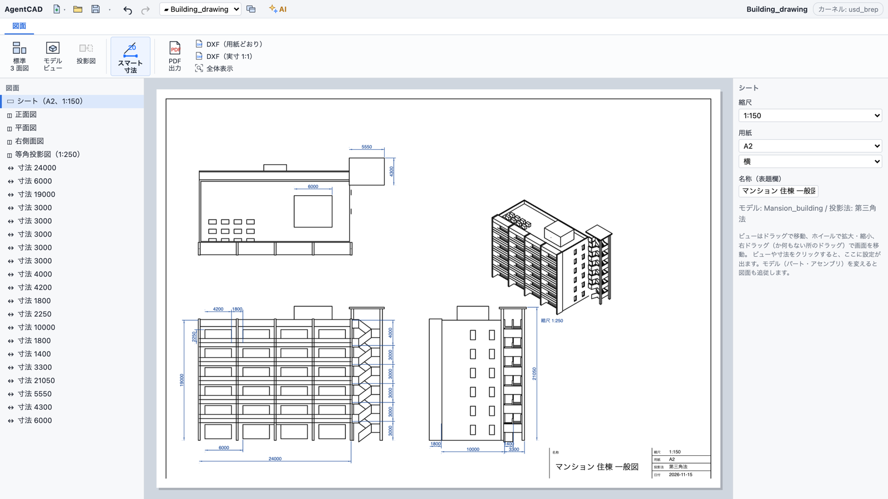
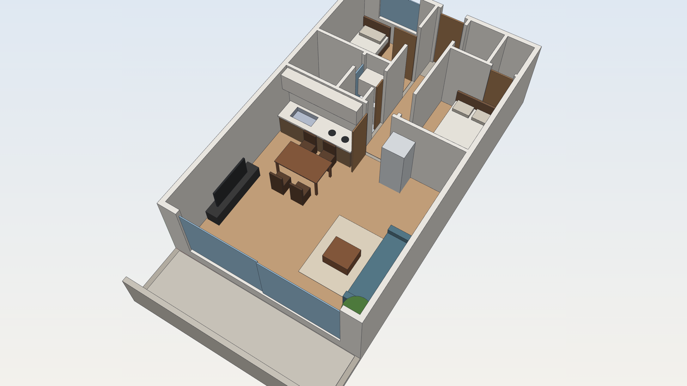
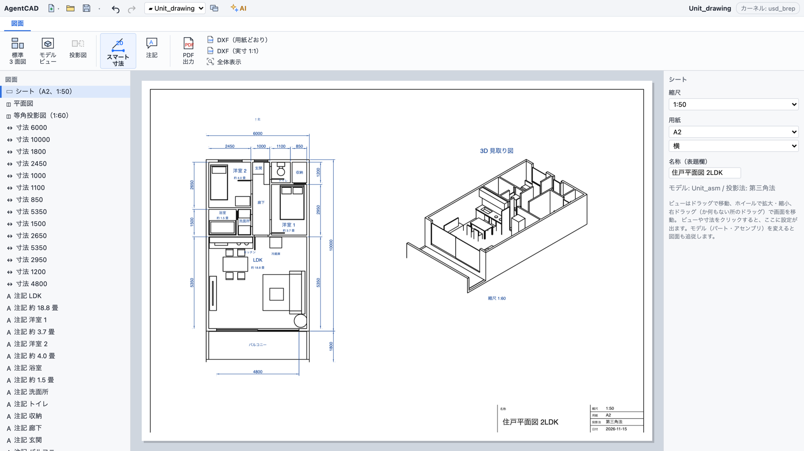
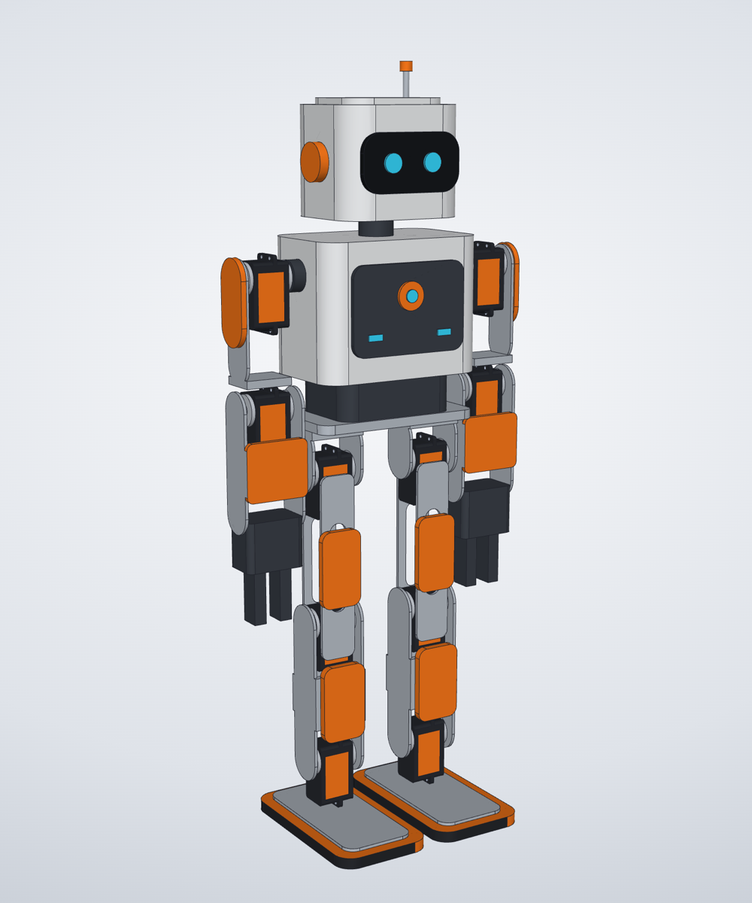
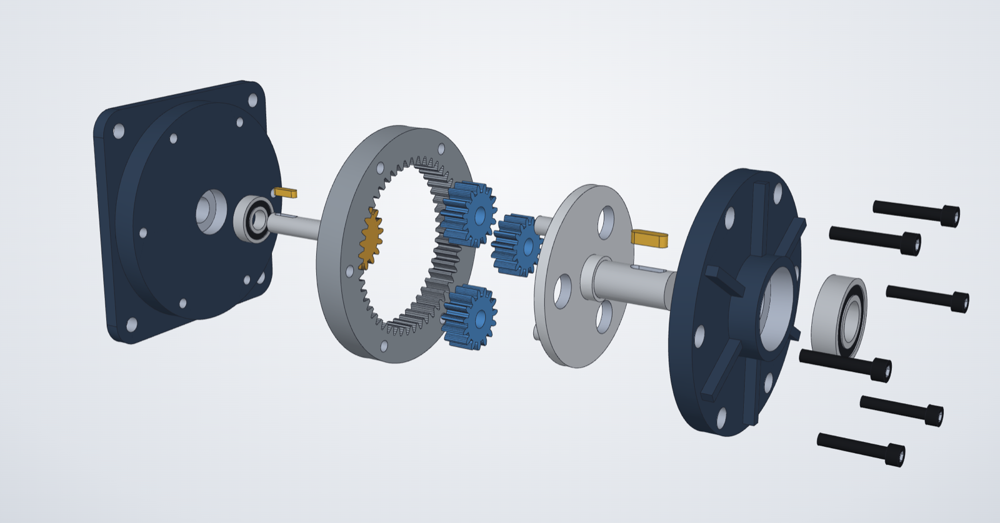

# AgentCAD

**English** | [日本語](README.ja.md)

> **Note: this is a personal project.** I built it for my own use. Please do not expect updates, bug fixes, or
> responses to issues and pull requests. Feel free to use it as a reference, or fork it and use it as you like
> (MIT License).

A parametric 3D CAD, developed by one person as an experimental project.
The sketch constraint solver, the feature tree and the assembly mates are implemented from scratch; the geometry
kernel (BRep) is [usd-brep](https://pypi.org/project/usd-brep/). The UI is a hand-written WebGL2 front end with no
external libraries, the logic is in Python, and the desktop version uses Tauri. Files are saved as OpenUSD (`.usda`).

**The UI and the design documents are in Japanese.** This README uses the Japanese labels where it refers to buttons.

Main features: sketches (constraints, Smart Dimension, inference and snapping), extrude / cut, revolve, sweep,
Hole Wizard, fillet, chamfer, shell, patterns, mirror, equations and variables, appearance (colors), section view,
assemblies (mates, interference check, "move it" preview), 2D drawings (PDF, DXF), and an AI assistant that builds
and edits models from natural language (Claude or any OpenAI-compatible API).

Examples (click an image to enlarge):

<table>
<tr>
<td><a href="docs/images/mansion.png"></a></td>
<td><a href="docs/images/mansion_drawing.png"></a></td>
<td><a href="docs/images/unit_3d.png"></a></td>
<td><a href="docs/images/unit_drawing.png"></a></td>
</tr>
<tr>
<td>Apartment building (6 floors). One floor of the staircase is a part, repeated 6 times with a component pattern</td>
<td>Drawing of the building (projected from the assembly, with dimensions)</td>
<td>3D cutaway of one unit (two bedrooms). Four parts: shell, floors, fixtures, furniture</td>
<td>Floor plan of the unit (dimensions, and notes for room names and sizes)</td>
</tr>
<tr>
<td><a href="docs/images/robot.png"></a></td>
<td><a href="docs/images/robot_drawing.png"></a></td>
<td><a href="docs/images/gearbox.png"></a></td>
<td><a href="docs/images/gearbox_drawing.png"></a></td>
</tr>
<tr>
<td>Small humanoid robot (488 mm tall). The 10 servos are one part used 10 times</td>
<td>Assembly drawing of the robot (four views, dimensions, parts list)</td>
<td>Exploded view of a planetary gear reducer (ratio 3.67). Involute tooth profiles; planets and bolts use circular patterns</td>
<td>Assembly drawing of the reducer (side view with hidden lines, diameter dimensions, gear data, parts list)</td>
</tr>
</table>

Note: all of these examples were generated by an AI agent through this application's API, and **they are not
practical designs**. Dimensions, structure and part breakdown are placeholders chosen for appearance; strength,
range of motion, constructability and the like were not considered.
The models (`.usda`), drawings, build scripts and screenshots are in [Data/](Data/) as samples
(`Mansion`, `Unit`, `Robot`, `Gearbox`; run each folder's `build_*.py` from `core` to regenerate them).

- Plan: [docs/PLAN.md](docs/PLAN.md) (Japanese)
- Specification: [docs/SPEC.md](docs/SPEC.md) (Japanese)
- Design decisions: [docs/DECISIONS.md](docs/DECISIONS.md) (Japanese)
- Developer handover notes: [CLAUDE.md](CLAUDE.md) (Japanese)

## Requirements
- Python 3.12 (usd-brep targets 3.12) and `pip install numpy scipy usd-brep` (developed with usd-brep 1.0.1)
- For the AI assistant: `pip install anthropic`. For tests: `pip install pytest` (and `pip install playwright` for the UI checks)
- Developed and checked on Windows. It also runs on macOS (Apple Silicon), but usd-brep has no macOS release, so it
  has to be built from source ([Building on macOS (Apple Silicon)](#building-on-macos-apple-silicon))

## Running (Windows)
Activate the venv above, then from the repository root:
```
run.bat --demo
```
A browser opens and shows a demo part (plate, boss, holes, fillets). `run.bat --demo car` shows the car demo part
(also available from 新規 ▾ → 「デモ（車）」). Press Ctrl+C in the console to quit.
Without usd-brep, the app runs on a simplified kernel (extrude and union only).

## AI assistant
Click 「AI」 on the standard toolbar (or 新規 ▾ → 「AI で作成…」) to open the panel on the right. The first time, enter
your API key under ⚙ (for Claude, an Anthropic API key; the default model is claude-opus-5-5). Set the provider to
「OpenAI 互換」 to use ChatGPT or local models such as Ollama and LM Studio (set the endpoint URL). Settings are
stored in `~/.agentcad/agent.json`.
Claude needs the SDK in the venv:
```
pip install anthropic
```

## Tests
```
cd core
python -m pytest
```
Requires Python 3.12+, numpy and scipy (the UI check `scripts/ui_smoke.py` also needs playwright and Chrome).

Solver benchmark: `cd core && python ../scripts/bench_solver.py`

Regeneration benchmark (needs usd-brep): `cd core && python ../scripts/bench_regen.py`

## Tests against the real kernel (Windows, from the repository root)
The kernel is usd-brep (investigation notes: [docs/PHASE0.md](docs/PHASE0.md)).
```
python -m pytest core\tests\test_kernel_conformance.py core\tests\test_part_real_kernel.py -v -s
```
With `-s`, regeneration times are printed as well.

## Controls
| Action | How |
|---|---|
| Toolbars | Row 1: new, open, save, undo. Row 2: tabs (フィーチャー features / スケッチ sketch / アセンブリ assembly). Display controls are at the top center of the 3D view |
| Rotate / pan / zoom | Middle-drag / Ctrl+middle-drag (or right-drag) / wheel (Shift+middle-drag) |
| View orientation | Ctrl+1–7 (front, back, left, right, top, bottom, isometric), Ctrl+8 = normal to the selected face or plane, F = fit |
| Start a sketch | Select a face or a plane in the tree, then 「スケッチ」 |
| Create a feature | Click its button → change values in the right panel → ✓ (Enter) to accept / ✗ (Esc) to cancel |
| Pattern / mirror | Select the seed extrude or cut in the tree, then click the button. Direction, axis and plane are chosen in the right panel |
| Sketch constraints | Click entities (Ctrl to add; the red origin point is selectable too) → the right panel shows the constraints that can be added |
| Sketch dimensions | 「スマート寸法」 (D) on the sketch tab → click entities → click where to place it → enter the value. Example: origin and a rectangle edge → place → 20 |
| Snapping | While drawing, the cursor snaps to midpoints, circle centers and endpoints (of this sketch, other sketches and model edges) and adds the constraint. Blue dotted inference lines appear when aligned with an existing point |
| Dimension targets | Smart Dimension can also pick points and edges of other sketches and of the model (corners, midpoints, circle centers, straight edges). They follow when the model changes |
| Selection filter | Left end of the bar above the 3D view: faces only / edges only / vertices only |
| Loops and "select other" | Right-click an edge → select loop / select tangency chain. Right-click a face → select other (pick a face behind) |
| Measure / mass properties | The 評価 (evaluate) tab. For measuring, click faces, edges or vertices (two items give distance and angle); Esc to finish |
| Assembly tools | Assembly tab: linear / circular component pattern, interference check. ⧉ in the component list copies a component; click a name in the mate list to edit the mate |
| Sweep | Draw a path sketch (connected lines and arcs) and a profile sketch (closed) perpendicular to the start of the path → select the profile sketch → 「スイープ」 → ✓. For a cut, change the operation in the right panel |
| Drawings | Open a part or an assembly, then 新規 ▾ → 図面 (with the standard three views). Drawing tab: model view, projected view, Smart Dimension, notes, PDF, DXF (as on the sheet / full scale 1:1). Scale and sheet size are in the right panel. Drag a view to move it; wheel to zoom |
| Hole Wizard | Select a face → 「穴ウィザード」 → place points for the holes → finish the sketch → choose the type (counterbore, countersink, drill, tap drill) and size (M2–M20) in the right panel → ✓ |
| Other sketches | Unused sketches are shown; a sketch selected in the tree is always shown. Right-click to show / hide. While sketching you can snap to their points and lines (the reference follows) |
| Mates | In an assembly, 「📎 合致」 → click two faces → the component moves → choose type, value and alignment in the popup → ✓ (continue with the next) / ✗. Click ✓ on the right when done |
| Windows | 「開く」 on a component opens the part in another window. 「⧉」 opens another document in another window. In the desktop version, new and open also use separate windows |
| Menus | Right-click in the tree or the 3D view (edit, rename, suppress, delete, sketch on this face, …) |
| Rename / delete | F2 / Del |

When running in a browser, Ctrl+1–8 may be taken by the browser's tab switching (they work in the desktop version,
and the same views are available from 「表示方向」 on the toolbar).

## Desktop version (Tauri)
Runs in its own window instead of a browser. Requirements: Node.js, [Rust](https://rustup.rs/), and the Visual
Studio C++ build tools.

Tell it where Python is (once). Create `agentcad.config.json` in the repository root (example: `agentcad.config.example.json`).

```json
{ "python": "C:\\path\\to\\venv\\Scripts\\python.exe", "kernel": "auto" }
```

```
cd app
npm install
npm run tauri dev      :: run for development (the first build takes a few minutes)
npm run tauri build    :: build the executable → app\src-tauri\target\release\agentcad.exe
```

Keep `agentcad.exe` inside the repository (it looks for `core` and starts the Python server).
To put it elsewhere, set the environment variable `AGENTCAD_ROOT` to the repository location.
The Python server's output goes to `%TEMP%\agentcad-server.log`.

## Building on macOS (Apple Silicon)
usd-brep is published for Linux and Windows only (PyPI and GitHub Releases), so on macOS it is built from source
(official instructions: "macOS local development" in usd-brep's `BUILDING.md`). The official steps alone did not
work, so this section records the steps that worked in November 2026 on macOS (Apple Silicon) with Xcode 26
(clang 21). The whole process takes about 30 minutes.
Below, sources go in `~/src` (with AgentCAD already cloned to `~/src/AgentCAD`) and OpenUSD is installed to `~/opt`
(usd-brep's default). Run all commands in the same shell (later steps use environment variables set earlier).

### Requirements
- Xcode (or the command line tools), git
- [uv](https://docs.astral.sh/uv/) (to create Python 3.12 and the venv), CMake (`brew install cmake`)
- For the desktop version: Node.js and [Rust](https://rustup.rs/)

### 1. Python 3.12 venv
Create `.venv` in the AgentCAD repository root (it is in `.gitignore`).
```
export SRC=~/src
export USD_ROOT=~/opt/usd-25.11-py312
export JOBS="$(sysctl -n hw.ncpu)"

cd "$SRC/AgentCAD"
uv venv --python 3.12
source .venv/bin/activate
uv pip install numpy scipy pytest playwright anthropic
```
A uv venv has no pip, so add packages with `uv pip install`.

### 2. OpenUSD 25.11 (for Python 3.12, without imaging)
```
git clone --depth 1 --branch v25.11 https://github.com/PixarAnimationStudios/OpenUSD.git "$SRC/OpenUSD"
python "$SRC/OpenUSD/build_scripts/build_usd.py" "$USD_ROOT" \
  --no-imaging --no-examples --no-tutorials --no-tools --no-docs --no-materialx \
  --python --build-variant release -j "$JOBS" \
  --build-args USD,"-DPXR_PY_UNDEFINED_DYNAMIC_LOOKUP=ON"
```
- `-DPXR_PY_UNDEFINED_DYNAMIC_LOOKUP=ON` is required. uv's Python has libpython linked statically into the
  executable, so without this option USD loads a second libpython and crashes on `import` (segmentation fault)
- Put the install location (`$USD_ROOT`) before `--build-args` (after it, it is taken as a value of `--build-args`)
- Check: `PYTHONPATH="$USD_ROOT/lib/python" python -c "from pxr import Usd"` should print no error

### 3. premake 5.0.0-beta2
The macOS build of the premake that usd-brep uses is not published. Homebrew's premake (5.0.0 final) cannot read
usd-brep's configuration (`flags`), so build 5.0.0-beta2, the same version as on Linux, from source.
One line of the bundled zlib has to be patched to build with the current clang.
```
cd "$SRC"
curl -fsSLO https://github.com/premake/premake-core/releases/download/v5.0.0-beta2/premake-5.0.0-beta2-src.zip
unzip -q premake-5.0.0-beta2-src.zip && cd premake-5.0.0-beta2-src
sed -i '' 's|#        define fdopen(fd,mode) NULL /\* No fdopen() \*/|/* fdopen patched out */|' contrib/zlib/zutil.h
CFLAGS="-Wno-implicit-function-declaration -include unistd.h" make -C build/gmake2.macosx config=release -j "$JOBS"
```
Put the resulting `bin/release/premake5` in the packman cache where the usd-brep build looks for it (the directory
name is the version usd-brep asks for).
```
D="$HOME/Library/Application Support/packman-cache/chk/premake/5.0.0-beta1+nv1-macos-universal"
mkdir -p "$D" && cp bin/release/premake5 "$D/" && touch "$D/.packman.sha1"
```

### 4. usd-brep 1.0.1
```
git clone --depth 1 --branch v1.0.1 https://github.com/NVIDIA-Omniverse/usd-brep.git "$SRC/usd-brep"
cd "$SRC/usd-brep"
```
Patch three places in the build configuration (run the `git apply` below as is).
- `premake5-libraries.lua`: for the same reason as in step 2, shared libraries and extension modules must not link libpython
- `premake5-utils.lua`: do not stop the build on the warnings added in clang 21 (`-Wno-error`)
- `repo.toml`: the macOS dependency entry is not used (the host is evaluated as `macos-aarch64`), so add the same entry for it
```
git apply <<'EOF'
--- a/premake5-libraries.lua
+++ b/premake5-libraries.lua
@@ -126,9 +126,12 @@ function use_python()
         libdirs { target_deps.."/python/libs" }
         externalincludedirs { target_deps.."/python/include" }
     filter { "system:macosx" }
+        externalincludedirs { target_deps.."/python/include/python3.12" }
+    filter { "system:macosx", "kind:SharedLib" }
+        linkoptions { "-undefined dynamic_lookup" }
+    filter { "system:macosx", "kind:not SharedLib" }
         links { "python3.12" }
         libdirs { target_deps.."/python/lib" }
         linkoptions { "-Wl,-rpath," .. target_deps .. "/python/lib" }
-        externalincludedirs { target_deps.."/python/include/python3.12" }
     filter {}
 end
--- a/premake5-utils.lua
+++ b/premake5-utils.lua
@@ -120,6 +120,7 @@ function macos_warning_suppressions()
         "-Wno-unused-but-set-variable",
         "-Wno-unused-variable",
         "-Wno-parentheses-equality",
+        "-Wno-error",
     }
 end
 
--- a/repo.toml
+++ b/repo.toml
@@ -55,6 +55,9 @@ fetch.packman_target_files_to_pull = [
 fetch."platform:macos-universal".packman_target_files_to_pull = [
     "${root}/deps/target-deps-python-macos.packman.xml",
 ]
+fetch."platform:macos-aarch64".packman_target_files_to_pull = [
+    "${root}/deps/target-deps-python-macos.packman.xml",
+]
 
 msbuild.sln_file = "usd-brep.sln"
 
EOF
```
Build (with the venv still active). `SMLIB_PYTHON_ROOT` is the Python the venv was created from;
`SMLIB_MACOS_ARM64_ONLY=1` builds arm64 only (OpenUSD is arm64 only, so the default universal build cannot link).
```
export SMLIB_PYTHON_ROOT="$(python -c 'import sys; print(sys.base_prefix)')"
export SMLIB_MACOS_ARM64_ONLY=1
export SMLIB_USD_ROOT="$USD_ROOT"
./tools/scripts/setup-macos-local-deps.sh
./prebuild.sh -p macos-universal
./repo.sh build -p macos-universal -r -j "$JOBS"
```
Make it available to the venv. A `.pth` file points at the build output, and the schema needed for saving USD
(omniSolid) is symlinked to where `usd_brep` looks for it (no environment variables needed).
```
echo "$PWD/_build/macos-universal/release" > "$(python -c 'import site; print(site.getsitepackages()[0])')/usd_brep_local.pth"
ln -sfn ../schema/omniSolid _build/macos-universal/omniSolid
```
Check: `python -c "import usd_brep as ub; print(len(ub.primitives.create_box((0,0,0),1,1,1).faces()))"` prints 6.
AgentCAD's tests (`cd core && python -m pytest -q`) then run the real-kernel tests too.

Redo step 4 after deleting `_build` or updating uv's Python (which changes `sys.base_prefix`).

### Running (macOS)
```
cd core
python -m cad.api --demo
```
The desktop version follows the same steps as "Desktop version (Tauri)" above. In `agentcad.config.json`, set
`python` to the venv's Python (for example `/Users/<username>/src/AgentCAD/.venv/bin/python`). The Python server's
output goes to `$TMPDIR/agentcad-server.log`.

## Exchanging data with other software (STL, 3MF, OBJ)
- **Export**: ▾ next to the save button → 「STL / 3MF / OBJ で書き出し…」. Both parts and assemblies can be exported
  (units: mm). Use 3MF (per component, with colors) or STL for 3D printing, and OBJ for Blender (colors go in the
  `.mtl` file of the same name). 「細かさ」 in the same menu sets how finely curved surfaces are triangulated
  (coarse / standard / fine)
- **Import**: choose a `.stl` / `.3mf` / `.obj` file with 「開く」 (open) to get a new part holding the imported shape.
  It can be displayed, measured, sketched on, used as an assembly component with mates, and used in drawings, but
  it cannot be modified (no added extrudes, cuts, fillets and so on)
- STEP is not supported

## File format
USD text files (`.usda`). A part stores its feature definitions, display mesh and BRep (referenced as
`<name>_body.usda`); an assembly references its parts (details: [docs/SPEC.md](docs/SPEC.md), chapter 8, in
Japanese). The older `.ucpart` / `.ucasm` files can still be opened.

## License
[MIT](LICENSE). Dependencies such as usd-brep are under their own licenses.
